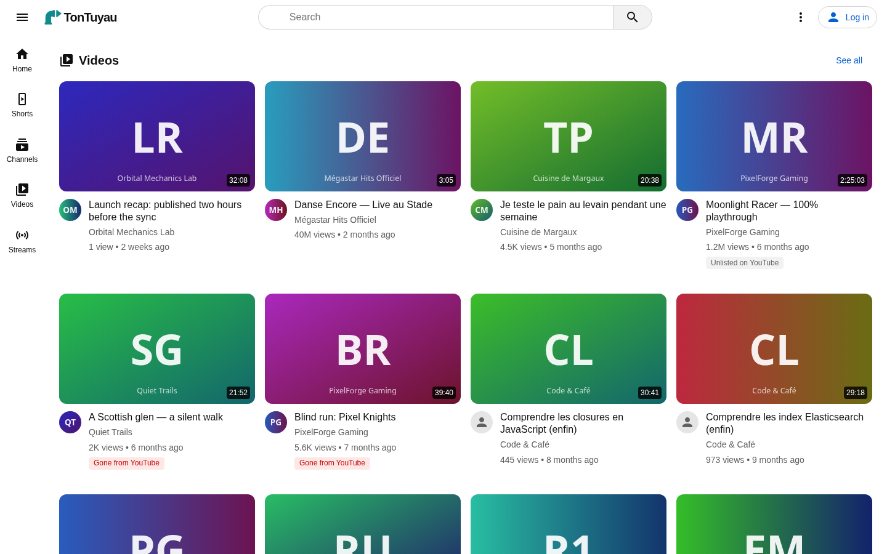
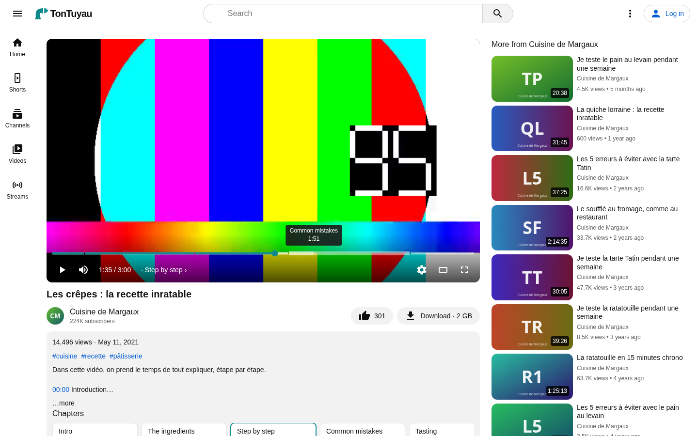
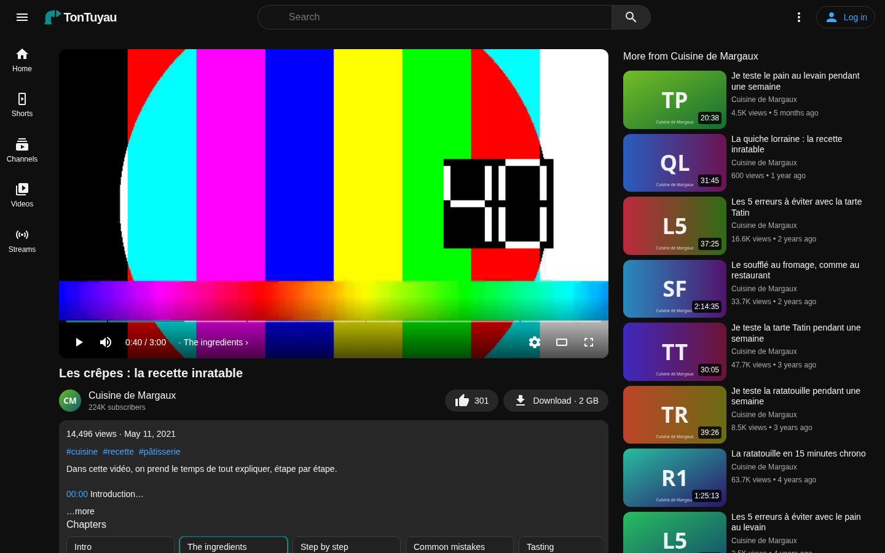
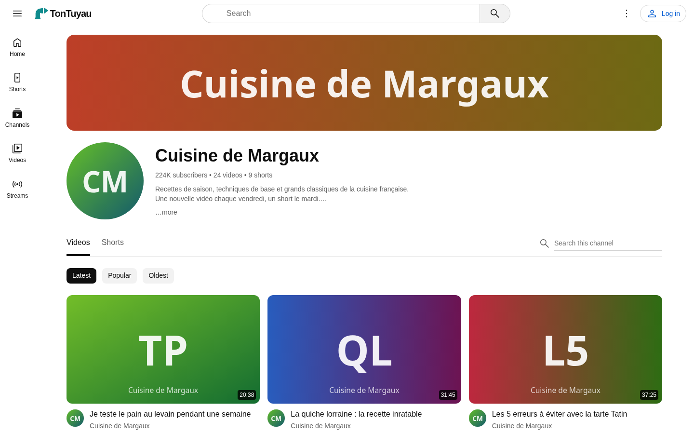
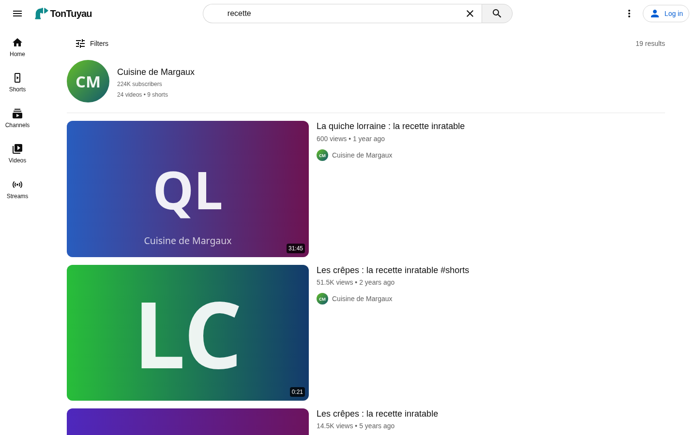
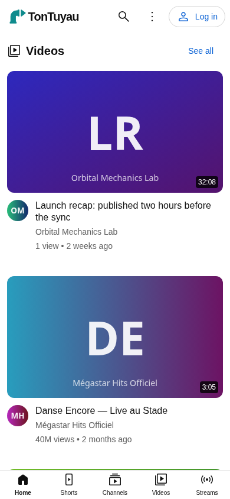

<div align="center">


# TonTuyau

**Your own YouTube, at home.**<br>
A self-hosted video library that looks and feels like YouTube, fills itself from YouTube, and keeps everything on your
disks.

[](https://github.com/TonTuyau/TonTuyau/actions/workflows/ci.yml)
[](https://github.com/TonTuyau/TonTuyau/releases/latest)
[](LICENSE)
[](https://github.com/orgs/TonTuyau/packages)
<br>
[](https://chromewebstore.google.com/detail/lapompe/cbijokghilmbekhefojdfoipjiefmoio)
[](https://addons.mozilla.org/firefox/addon/lapompe/)

<sub>*Ton tuyau*: French for "your pipe", or "your tube".</sub>

</div>

<p align="center">
  
</p>

## Why TonTuyau

Channels disappear, videos get taken down, and a library you love can vanish overnight. TonTuyau keeps the videos you
care about on your own server, and gives them back to you in the interface you already know: the same home page, the
same watch page, the same search, on your computer and your phone.

- 🏠 **Feels like home.** A YouTube-like web app: home feed, channels, Shorts, streams, search with suggestions and
  filters, light and dark themes, a phone layout. In English and French.
- ⬇️ **Fills itself.** Subscribe to channels and TonTuyau downloads their new videos, Shorts and streams on a
  schedule (yt-dlp), or grab a single video by its link.
- ▶️ **Plays anything, instantly.** The original files, never transcoded, streamed in parts so a long video starts
  and seeks at once. Speed, chapters, loop, keyboard shortcuts.
- 📦 **Brings your library.** Coming from [TubeArchivist](https://github.com/tubearchivist/tubearchivist)? TonTuyau
  imports its whole library (read-only), then you can shut it down.
- 🔌 **One click from YouTube.** With [LaPompe](#-lapompe-the-browser-extension), an "Add to TonTuyau" button sits
  next to Subscribe on YouTube itself.
- 🔒 **Yours.** No sign-up, no tracking, no cloud ([privacy](PRIVACY.md)). Browsing needs no login; one admin account
  runs the library, from a dashboard, a Tasks page and a command line.

## A look around

<table>
  <tr>
    <td width="50%"></td>
    <td width="50%"></td>
  </tr>
  <tr>
    <td align="center"><sub>Watching: the player and its controls</sub></td>
    <td align="center"><sub>The same, in the dark theme</sub></td>
  </tr>
  <tr>
    <td></td>
    <td></td>
  </tr>
  <tr>
    <td align="center"><sub>A channel, its videos and Shorts</sub></td>
    <td align="center"><sub>Search, channels first, with filters</sub></td>
  </tr>
</table>

<p align="center">
  <br>
  <sub>And on a phone</sub>
</p>

<sub>The screenshots show TonTuyau's synthetic demo library.</sub>

## 🧲 LaPompe, the browser extension

<picture>
  <source media="(prefers-color-scheme: dark)" srcset="https://raw.githubusercontent.com/TonTuyau/LaPompe/main/icons/lapompe-light.svg">
  
</picture>

*LaPompe remplit TonTuyau*: "the pump fills your pipe".

[LaPompe](https://github.com/TonTuyau/LaPompe) connects your browser to your TonTuyau:

- **"Add to TonTuyau"** next to Subscribe on YouTube's video and channel pages: one click downloads the video, or
  subscribes TonTuyau to the channel. Where TonTuyau already has it, the button says so.
- **Keeps TonTuyau signed in to YouTube**, by sending it your youtube.com cookie now and then, so its downloads work
  as yours do. Only to the TonTuyau address you set, nowhere else
  ([privacy](https://github.com/TonTuyau/LaPompe/blob/main/PRIVACY.md)).

<p>
  <a href="https://chromewebstore.google.com/detail/lapompe/cbijokghilmbekhefojdfoipjiefmoio"></a>
  <a href="https://addons.mozilla.org/firefox/addon/lapompe/"></a>
</p>

To connect it: in TonTuyau, **Admin → API keys → New key**, of kind "Browser extension"; then in LaPompe's settings,
your TonTuyau's address and that key, and **Test the connection**.

## Contents

- [Install with Docker](#install-with-docker)
- [Configuration](#configuration)
- [Logging in](#logging-in)
- [Command line](#command-line)
- [Updating and upgrading](#updating-and-upgrading)
- [Backups](#backups)
- [Security](#security) and [privacy](PRIVACY.md)
- [REST API](#rest-api)
- [Development](#development)
- [License](#license)

## Install with Docker

TonTuyau runs as four containers:

| Container | Role |
|---|---|
| `tontuyau-frontend` | the web app; also forwards `/api`, `/media` and `/art` to the backend. The only one reachable from the LAN (port 80 by default) |
| `tontuyau-backend` | the API, the downloads, the import and the `tontuyau` command line |
| `tontuyau-db` | PostgreSQL: the library, the accounts, the runs |
| `tontuyau-reservoir` | its own Elasticsearch: the search indices, written from PostgreSQL |

The images are `ghcr.io/tontuyau/tontuyau-backend` and `ghcr.io/tontuyau/tontuyau-frontend` (`linux/amd64`). They carry
only what TonTuyau needs: no shell, no package manager.

### Prerequisites

- A Linux machine or VM (x86-64) with Docker Engine and the Compose plugin (`docker compose version`). The stack sets
  **no CPU or memory limits**. Elasticsearch takes a fixed heap, `TONTUYAU_ES_HEAP` (4 GB by default), plus its file
  cache: about 8 GB of RAM in total and 4+ cores are comfortable. To cap a container, add `deploy.resources.limits` in
  a `docker-compose.override.yml` next to the compose file.
- For Elasticsearch: `sudo sysctl -w vm.max_map_count=262144`, and the same line, `vm.max_map_count=262144`, in
  `/etc/sysctl.d/99-tontuyau.conf` so it survives a reboot.
- About 10 GB of local disk for the volumes (the index, the channels' and videos' images and their resized versions),
  plus about 3.5 GB for the Docker images.
- A folder for the videos, as big as your library will be.
- Optionally, to import a TubeArchivist library: its URL and an API token (TubeArchivist → Settings → API token).

### 1. The videos folder

TonTuyau keeps the videos in **one folder**, one folder per channel: `<channel id>/<video id>.<ext>`. Coming from
TubeArchivist, that's its `youtube` folder, as it is. Set its path in `.env` as `TONTUYAU_MEDIA_PATH` (for example
`/mnt/youtube`): a local folder or a mounted share.

TonTuyau writes its downloads there (`<channel id>/<video id>.mkv`), through a hidden `.tontuyau-downloads` folder
first, so a half-downloaded file never shows. What it writes is group-writable (folders 775, files 664); the files it
didn't make are never changed.

The backend runs as `TONTUYAU_UID`:`TONTUYAU_GID` (1654:1654 by default): make it fit the folder. Most of the time the
group is enough: the folder's group (`stat -c '%u %g' /mnt/youtube`), with group write on the folder.

```bash
TONTUYAU_GID=1001   # in .env: the videos folder's group; the downloads then belong to it too
```

<details>
<summary>A share only its owner can write to, or leaving 1654 as it is</summary>

Set `TONTUYAU_UID` to the folder owner's uid too (an NFS export without id mapping, for instance). A uid other than
1654 then needs the art and tools volumes to belong to it, once (`tontuyau_` is the project's prefix, as
`docker volume ls` shows):

```bash
docker run --rm -v tontuyau_tontuyau-art:/a -v tontuyau_tontuyau-tools:/t busybox chown -R "$TONTUYAU_UID:$TONTUYAU_GID" /a /t
```

Or keep 1654 and let that user write: `sudo setfacl -R -m u:1654:rwX -m d:u:1654:rwX /mnt/youtube`. On an NFS share,
the export must allow writing for that user (or map it with `all_squash`/`anonuid`). A download that can't write fails
with "The media folder can't be written to".

</details>

If the folder doesn't exist, `docker compose up` stops with an error rather than starting with no videos.

### 2. The compose file and `.env`

In an empty folder (for example `/opt/tontuyau`), put [`docker/docker-compose.yml`](docker/docker-compose.yml) and
[`.env.example`](.env.example) from this repository, then:

```bash
cp .env.example .env
chmod 600 .env
```

Fill in `TONTUYAU_ES_PASSWORD` and `TONTUYAU_DB_PASSWORD` (long random strings: `openssl rand -base64 24`),
`TONTUYAU_MEDIA_PATH`, and `TONTUYAU_ADMIN_PASSWORD`, the admin account's password, read at the first start only. To
import a TubeArchivist library, also `TONTUYAU_TA_URL` and `TONTUYAU_TA_TOKEN`. Every other variable has a default;
`.env.example` explains each one.

### 3. Start

```bash
docker compose pull && docker compose up -d
docker compose ps        # all four "healthy" after a minute or two
```

Then open `http://<server>/` (or the port in `TONTUYAU_HTTP_PORT`), log in as the admin, and add your first channels
from the **YouTube** page, or with LaPompe's button on YouTube.

### 4. Importing a TubeArchivist library (optional)

With `TONTUYAU_TA_URL` and `TONTUYAU_TA_TOKEN` set, **the backend imports TubeArchivist's library each time it
starts**, in the background, while the app already answers. It reads the whole library (read-only: TubeArchivist is
never changed), adds the videos and channels TonTuyau doesn't have, with their subscriptions, copies their images and
makes their resized versions, then checks their files. A library of about 45,000 videos takes **about 20 minutes**.
Nothing is ever deleted: run again, an import only adds what's new.

Once it ran (the Tasks page shows it, or `docker exec tontuyau-backend tontuyau status`), **TubeArchivist can be shut
down**: remove the two settings from `.env` and `docker compose up -d`.

To follow it, or to run one by hand:

```bash
docker exec -it tontuyau-backend tontuyau import
```

```
[00:00] channels      0 / 150 read
[00:41] videos        12 / 150 channels · 4,210 videos · art 4,180 copied, 8,350 resized
[19:05] media check   45,339 files checked · 2 missing
```

<details>
<summary>Using folders instead of volumes</summary>

The stack keeps PostgreSQL's and Elasticsearch's data, the images and the yt-dlp versions in **named volumes**. To
have them in folders instead (bind mounts), give the folders their owners once, before `docker compose up`, since
Docker creates a missing one as `root`:

```bash
sudo chown -R 1000:0 <es-folder> && sudo chmod -R g+rwX <es-folder>   # Elasticsearch runs as uid 1000, group 0
sudo chown -R 1654:1654 <art-folder> <tools-folder>                   # the backend's TONTUYAU_UID:TONTUYAU_GID
```

Then name them in a `docker-compose.override.yml` next to the compose file: Compose reads it by itself, and taking a
newer compose file doesn't undo it.

```yaml
services:
  tontuyau-reservoir:
    volumes:
      - /srv/tontuyau/es:/usr/share/elasticsearch/data
  tontuyau-backend:
    volumes:
      - /srv/tontuyau/art:/data/art
      - /srv/tontuyau/tools:/data/tools
```

</details>

### Logs

```bash
docker compose logs -f tontuyau-backend      # the API, the downloads, the import, the runs
docker compose logs --tail 100 tontuyau-frontend
```

Every run's log is also on the admin's Tasks page. The images have no shell: `docker exec … sh` doesn't work, but
`docker debug tontuyau-backend` attaches a temporary toolbox without changing the image.

## Configuration

All settings are environment variables prefixed `TONTUYAU_` (see [.env.example](.env.example)). The backend **refuses
to start** with a missing or invalid value, and says which one. In the Docker stack, `.env` holds them; the compose
file fixes `TONTUYAU_ES_URL` (`http://tontuyau-reservoir:9200`) and the paths (`/youtube`, `/data/art`, `/data/tools`),
and passes every other one through (empty = the default below).

| Variable | Required | Default |
|---|---|---|
| `TONTUYAU_ES_URL` | yes | |
| `TONTUYAU_ES_USERNAME` | no | `elastic` |
| `TONTUYAU_ES_PASSWORD` | yes | |
| `TONTUYAU_ES_INDEX_PREFIX` | no | `tontuyau` (indices `tontuyau-videos-v1`… behind aliases `tontuyau-videos` / `tontuyau-videos-write`) |
| `TONTUYAU_DB_HOST` | no | `tontuyau-db` (`host` or `host:port`; fixed in the stack) |
| `TONTUYAU_DB_NAME` | no | `tontuyau` |
| `TONTUYAU_DB_USERNAME` | no | `tontuyau` |
| `TONTUYAU_DB_PASSWORD` | yes | |
| `TONTUYAU_ADMIN_USER` | no | `admin`: the account the first start creates |
| `TONTUYAU_ADMIN_PASSWORD` | at the first start | its password; read only while there's no account at all |
| `TONTUYAU_MEDIA_ROOT` | no | `/youtube` |
| `TONTUYAU_ART_ROOT` | no | `/data/art` |
| `TONTUYAU_TOOLS_ROOT` | no | `/data/tools`: where the yt-dlp versions TonTuyau downloads go |
| `TONTUYAU_TZ` | no | `Europe/Paris`: the dashboard's days |
| `TONTUYAU_COOKIE_SECURE` | no | `true`: the login cookie only travels over HTTPS; `false` to browse over plain `http://` |
| `TONTUYAU_TRUSTED_PROXIES` | no | empty. Your reverse proxy's address (several: commas), so each visitor behind it gets their own login attempts |
| `TONTUYAU_PUBLIC_URL` | no | empty: no link previews. The address people reach TonTuyau at (`https://tontuyau.example.net`, no path): a link shared in Discord, Messenger… then shows the channel, the title and the video |
| `TONTUYAU_TA_URL` | no | empty: no import. TubeArchivist's address, for the import at startup; both or neither |
| `TONTUYAU_TA_TOKEN` | no | empty. Its API token |
| `TONTUYAU_TA_RESULT_WINDOW` | no | `10000` (TubeArchivist's list window) |
| `TONTUYAU_ART_RESIZE_PARALLELISM` | no | the backend container's core count: how many images the import resizes at once (1–64) |
| `TONTUYAU_CLI_SOCKET` | no | `/tmp/tontuyau.sock`: the Unix socket the command line reaches the backend through, inside the container (empty: no command line) |
| `TONTUYAU_YTDLP_PATH` | no | `yt-dlp`: the image has it, pinned; TonTuyau can update it from the YouTube page |
| `TONTUYAU_DENO_PATH` | no | `deno`: what yt-dlp runs YouTube's JavaScript with; the image has it, pinned |
| `TONTUYAU_FFMPEG_PATH` | no | `ffmpeg`: merges the downloads and streams the videos in parts (ffprobe next to it); the image has both, pinned |

Read by the compose file only:

| Variable | Default |
|---|---|
| `TONTUYAU_VERSION` | `latest`: the images' tag (`2.0.0`, `2.0`, `latest`, or a pre-release to try, such as `2.1.0-alpha.1`) |
| `TONTUYAU_HTTP_PORT` | `80`: the web app's port, the only one the stack publishes |
| `TONTUYAU_MEDIA_PATH` | required: the videos folder on the host |
| `TONTUYAU_UID`, `TONTUYAU_GID` | `1654`, `1654`: who the backend runs as, to fit the videos folder |
| `TONTUYAU_ES_HEAP` | `4g`: Elasticsearch's heap |

The YouTube settings (how often to sync, the download format, LaPompe's cookie…) are on the admin's **YouTube**
page, not in `.env`.

## Logging in

Browsing needs no login. At its first start (no account yet) the backend creates the admin, `TONTUYAU_ADMIN_USER`
with `TONTUYAU_ADMIN_PASSWORD`; later starts never read them again. Passwords are stored as OWASP recommends (Argon2id,
19 MiB, 2 passes, a random salt each).

**Log in** (top right) opens a session: an HttpOnly, SameSite=Strict, Secure cookie, valid 8 hours and renewed while
in use, or 30 days with "Stay logged in". A restart keeps everyone logged in.

**Accounts** (2.3.0): an admin makes more on the admin's **Accounts** page, each an **admin** (everything) or a
**user** (watches the library, no administration), and can change their role or password, disable or delete them. The
last enabled local admin stays, and nobody disables nor deletes their own account. Each one changes its own password
on **My account** (the account menu). A session is checked against its account every 5 minutes: an account disabled,
deleted, or whose role or password changed, is logged out then.

- **HTTPS**: the cookie is `Secure`, so browsers only keep it over HTTPS (and on `localhost`). Over plain `http://` on
  the LAN, set `TONTUYAU_COOKIE_SECURE=false`.
- **Password guessing**: 5 attempts a minute per client address, then 429. Behind a reverse proxy, name it in
  `TONTUYAU_TRUSTED_PROXIES` so each visitor gets their own 5 attempts (read from the `X-Forwarded-For` it adds).

## Command line

The backend's image puts `tontuyau` on the PATH; everything it does, the admin's pages do too.

| Command | What it does |
|---|---|
| `tontuyau status` | the library's counts and the last runs |
| `tontuyau youtube add-channel <id\|@handle\|link> [videos,shorts,streams]` | subscribes to a channel (its default tabs when none is named) |
| `tontuyau youtube sync` | downloads what's new on the subscribed channels (also every 6 hours by itself, a setting of the YouTube page) |
| `tontuyau youtube full-sync [<channel id>]` | lists the channels whole and downloads all the library doesn't have, missing files included |
| `tontuyau youtube download <id\|link>` | downloads one video, adding its channel when it's new |
| `tontuyau youtube retry <channel id>` | tries a channel's failed downloads again |
| `tontuyau youtube refresh-all [days]` | reads every channel and video again on YouTube (titles, views…), skipping what was read in the last days (7) |
| `tontuyau youtube video\|channel\|channel-videos <id>` | reads one video, one channel, or a channel and its videos again |
| `tontuyau import` | imports TubeArchivist's library |
| `tontuyau index rebuild` | writes the search indices again from PostgreSQL |
| `tontuyau health` | whether the backend answers (exit code 0 or 1): the container's health check |
| `tontuyau --version` | the version |

Run them with `docker exec tontuyau-backend tontuyau …` (`-it` to follow a run). Only one run goes on at a time: a run
started while another goes on waits its turn in the queue (the Tasks page lists it, with Cancel). The commands that
start a run print its log as it goes, then its report; Ctrl-C cancels it (what it did until then stays).

When YouTube refuses (too many requests, a sign-in asked for), the run is **put on hold** rather than failing, and
resumes from where it was: by itself later, or with **Resume now** on the Tasks page.

Exit codes: 0 done, 1 the run failed or was canceled, 2 usage or configuration error, 4 refused (a video the library
has, a channel already subscribed to, an import without TubeArchivist's settings), 5 put on hold.

## Updating and upgrading

```bash
docker compose pull && docker compose up -d
```

`TONTUYAU_VERSION` in `.env` picks the version: `latest`, or a pinned one (`2.0.0`, or `2.0` for the latest 2.0.x).
What each version brings, and anything to do before upgrading to it, is in its
[release notes](https://github.com/TonTuyau/TonTuyau/releases) (also in [docs/releases](docs/releases)).
When a new version changes the search index's definitions, **the backend rebuilds the index by itself at startup**,
from PostgreSQL, while still serving the current one. `docker exec tontuyau-backend tontuyau --version` says what runs.

Each month (the 15th), the latest release's images are rebuilt from the same sources on fresh base images, so the
base images' security fixes reach you without a new TonTuyau release: `docker compose pull && docker compose up -d`
takes them.

## Backups

| What | Content | Back it up? |
|---|---|---|
| `tontuyau-db-data` (volume) | the library, the accounts, the runs (PostgreSQL) | **Yes**: `docker exec tontuyau-db pg_dump -U tontuyau tontuyau > tontuyau-db.sql`. It's the only copy of the library |
| `TONTUYAU_MEDIA_PATH` (folder) | your videos | **Yes**, as any folder |
| `tontuyau-art` (volume) | the channels' and videos' images and their resized versions | **Yes** (while TubeArchivist is still there, an import copies them again) |
| `.env` | the settings and secrets | **Yes**, kept private |
| `tontuyau-es-data` (volume) | the search indices (Elasticsearch) | No: `tontuyau index rebuild` writes them again |
| `tontuyau-tools` (volume) | the yt-dlp versions TonTuyau downloaded | No: downloaded again |

A volume to a tarball: `docker run --rm -v tontuyau_tontuyau-art:/v:ro -v "$PWD":/b busybox tar czf /b/art.tgz -C /v .`
(Compose prefixes the volume names with the project's, `tontuyau_`: `docker volume ls` lists them.)

## Security

TonTuyau is designed for a home network. Before exposing it to the internet, put it behind a reverse proxy with HTTPS,
and keep in mind that **browsing needs no login**: anyone who reaches it sees the whole library.

What it already does as if it were public: the front server sends a strict **Content-Security-Policy** on every answer
(`default-src 'self'`, no inline script or style, no `data:` URLs, `object-src 'none'`, `frame-ancestors 'self'`; the
full policy is in [`frontend/server/server.ts`](frontend/server/server.ts)), with `X-Content-Type-Options: nosniff`,
`Referrer-Policy: same-origin` and `X-Frame-Options: SAMEORIGIN`; the build fails if the page gets anything the policy
would block. Only the web app's port is published; the command line reaches the backend through a Unix socket inside
its container only. The images run as a non-root user, with no shell.

What TonTuyau stores, where it connects, and what it never does: [PRIVACY.md](PRIVACY.md).

Found a vulnerability? Please report it privately, through the repository's **Security → Report a vulnerability**,
rather than in an issue.

## REST API

The library is read through a REST API under `/api`, `/media` and `/art`; its contract is
[docs/API_CONTRACT.md](docs/API_CONTRACT.md), and the backend publishes its OpenAPI document at `/openapi/v1.json`.
Lists are cursor-paged (`nextCursor`, exact `total`), errors are RFC 9457 ProblemDetails, and every answer carries
`X-TonTuyau-Version`.

```bash
curl -s 'http://<server>/api/home?size=2'
curl -s 'http://<server>/api/search?q=creme%20brulee'
curl -sI -H 'Range: bytes=0-99' 'http://<server>/media/<video id>'
```

`GET /health` answers as soon as the backend runs; `GET /health/ready` only once Elasticsearch and TonTuyau's indices
are usable (503 otherwise).

## Development

| Part | Stack |
|---|---|
| `backend/` | ASP.NET Core (.NET 10), EF Core on PostgreSQL, Elasticsearch 9; xUnit and Reqnroll tests on Testcontainers |
| `frontend/` | Svelte 5, Vite, TypeScript, pnpm, Vitest; `server/` is the front container's production server (plain Node) |
| `docker/` | the compose file, the two Dockerfiles, `compose.dev.yml` (Elasticsearch and PostgreSQL on localhost) |
| `scripts/` | `check.sh` (everything CI runs), `build-images.sh`, `check-version.sh`, `smoke-image.sh` |
| `docs/` | the API contract, the plans and the design notes |

Prerequisites: .NET 10 SDK, Node 24+, pnpm (`corepack enable`), Docker (your user in the `docker` group), and ffmpeg
for the streaming tests.

```bash
cp .env.example .env    # fill it in, and uncomment the "Development only" lines
./scripts/check.sh      # version, format, build and every test, back and front (--backend / --frontend for one)
```

Run it locally:

```bash
docker compose --env-file .env -f docker/docker-compose.yml -f docker/compose.dev.yml up -d tontuyau-reservoir tontuyau-db
set -a; . ./.env; set +a; cd backend && dotnet run --project src/TonTuyau.Api   # http://localhost:5080
cd frontend && pnpm install && pnpm dev                                         # http://localhost:5173
```

Or the front alone, on a synthetic library, with no backend at all: `cd frontend && pnpm run dev:mockup`, then `/__mock`
for its knobs (empty library, failing API, slow answers, logged in as admin for the admin pages).

<details>
<summary>The API types, the version, CI and the images</summary>

- The front's API types come from the backend's OpenAPI document: `frontend/src/lib/api/openapi.json` is a committed
  copy. After a backend change that alters it (a backend test then fails), start the backend and run
  `cd frontend && pnpm run api:openapi`.
- The version lives in `backend/Directory.Build.props` and `frontend/package.json`; `check.sh` fails when they differ.
- GitHub Actions runs on pull requests and version tags: `check.sh` (the backend's part only when the backend
  changed), then both images. A version tag `vX.Y.Z` publishes them to GHCR as `X.Y.Z`, `X.Y` and `latest`, then
  makes its GitHub Release from `docs/releases/X.Y.Z.md`; a pre-release tag (`v2.1.0-alpha.1`) publishes only its own
  image tag and a pre-release.
- `scripts/build-images.sh` builds the images locally (tag `dev`): run the stack with `TONTUYAU_VERSION=dev`.

</details>

## License

TonTuyau is free software: you can redistribute it and/or modify it under the terms of the
[GNU General Public License](LICENSE) as published by the Free Software Foundation, either version 3 of the License,
or (at your option) any later version. It is distributed in the hope that it will be useful, but WITHOUT ANY WARRANTY.

The backend image ships [FFmpeg](https://ffmpeg.org) (LGPL), [yt-dlp](https://github.com/yt-dlp/yt-dlp) (Unlicense)
and [Deno](https://deno.com) (MIT), unchanged, each under its own licence. The icons are Google's
[Material Symbols](https://fonts.google.com/icons) (Apache 2.0).

TonTuyau is not affiliated with, endorsed by, or sponsored by YouTube or Google. Download only what you have the right
to keep.
